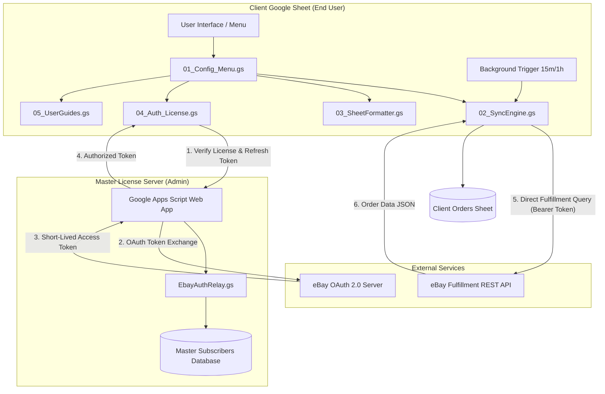

# ⚡ eBay Auto Data & Fulfillment Sync Hub

[](https://developers.google.com/apps-script)
[](https://developer.ebay.com/)
[](LICENSE)
[](#)

An enterprise-grade, automated **eBay Fulfillment Order Sync & Commercial Subscription Management System** built with **Google Apps Script** and **Google Sheets**.

This solution enables eBay sellers to automatically ingest, organize, and monitor orders across international marketplaces in real time, while empowering the system administrator with a centralized, secure **Master Licensing Relay** to monetize and control paid client subscriptions.

---

## 📑 Table of Contents

- [Key Features](#-key-features)
- [System Architecture](#-system-architecture)
- [Repository Structure](#-repository-structure)
- [Prerequisites](#-prerequisites)
- [Deployment Guide](#-deployment-guide)
  - [Part 1: Master License Server Setup (Admin)](#part-1-master-license-server-setup-admin)
  - [Part 2: Client Sheet Setup (End User / Client)](#part-2-client-sheet-setup-end-user--client)
- [How to Use](#-how-to-use)
- [Sync Conditions & Modes](#-sync-conditions--modes)
- [Security & Credential Protection](#-security--credential-protection)
- [Troubleshooting & FAQs](#-troubleshooting--faqs)
- [License](#-license)

---

## 🌟 Key Features

### 🔄 Dual Sync Engine & Flexible Conditions
- **Condition 1 (Incremental & Status Update):** Automatically syncs recent incoming orders (`Pending` and `Shipped`), updating existing order rows when tracking details or statuses change on eBay. Older delivered or canceled orders are omitted to keep the sheet clean.
- **Condition 2 (Full History Scan):** Comprehensive synchronization importing all order history (up to eBay's 90-day fulfillment limit), including past `Delivered` and `Cancelled` orders.
- **Custom Date Range Sync:** Interactive modal allowing clients to fetch orders between custom date ranges with built-in API safety guard rails (future date prevention and 89-day capping).

### ⏰ 24/7 Background Automation
- **Autonomous Cloud Triggers:** Configurable **15-Minute** and **1-Hour** background triggers running directly on Google Cloud infrastructure.
- **Headless Execution Safe:** Orders synchronize even when the spreadsheet is closed or the user's computer is turned off.
- **Lock Management:** Native `LockService` concurrency controls to prevent duplicate executions or race conditions.

### 🛡️ Commercial Subscription & SaaS Licensing
- **Credential Isolation:** eBay Developer `APP_ID`, `CERT_ID`, and `RU_NAME` are stored strictly on the private Master Relay Server. Client sheets never see or touch developer secret keys.
- **Master Subscriber Database:** Centralized Google Sheet recording subscriber email, client name, registration date (`dd-mmm-yyyy`), marketplace, and subscription status.
- **Pending Approval Workflow:** New client registrations default to `Pending` (`Pending Payment`), locking sync features until the admin verifies payment and activates the user.
- **Visual Status Chips:** Color-coded status badges (`Pending` = Amber, `Active` = Green, `Suspended` = Red, `Expired` = Gray).

### 📅 Timezone-Safe Live Date Filtering (Cell K1)
- **Live Search Box:** Enter any target date (`yyyy-MM-dd`) in Cell **K1** to instantly filter orders.
- **Zero Timezone Shifting:** Direct string pattern matching prevents timezone rollover bugs.
- **Month-Level Filtering:** Enter `yyyy-MM` (e.g. `2026-10`) to filter all orders for an entire month.
- **One-Click Clear:** Delete Cell K1 or choose *Clear Date Filter* from the menu to restore all records.

### 💱 Multi-Marketplace & Multi-Currency Support
- Native compatibility across international eBay portals: 🇮🇹 Italy (`.it`), 🇬🇧 UK (`.co.uk`), 🇺🇸 US (`.com`), 🇩🇪 Germany (`.de`), 🇫🇷 France (`.fr`), 🇪🇸 Spain (`.es`), 🇦🇺 Australia (`.com.au`), 🇨🇦 Canada (`.ca`), and more.
- Automatic financial formatting for native currencies (`€` EUR, `£` GBP, `$` USD, `A$` AUD, `CA$` CAD, `CHF`, `zł` PLN).

### 📊 Real-Time Financial Analytics & KPI Dashboard
- Automatic KPI summary cards dynamically tracking **Total Orders**, **Total Revenue**, **Total Deductions / Fees**, and **Net Earnings**.
- Clickable direct order links navigating straight to the native eBay Seller Hub order details page.

---

## 🏛️ System Architecture



---

## 📁 Repository Structure

```
.
├── google-apps-script/
│   ├── 01_Config_Menu.gs       # Configuration, top menus, triggers & onEdit listener
│   ├── 02_SyncEngine.gs        # Fulfillment API sync engine, pagination & sorting
│   ├── 03_SheetFormatter.gs    # Sheet layout, KPI cards, K1 date filter & currencies
│   ├── 04_Auth_License.gs      # Token refresh, license verification & Steps 1 & 2
│   ├── 05_UserGuides.gs        # Interactive UI modals (Settings, Date Range, FAQs)
│   ├── EbayAuthRelay.gs        # Master Relay Server (OAuth Secrets & License Database)
│   ├── EbayFulfillmentSync.gs  # Standalone all-in-one client script (alternative to modular)
│   └── appsscript.json         # Project manifest with explicitly declared OAuth scopes
└── README.md                   # Project documentation
```

---

## 🔧 Prerequisites

1. **Google Account:** Required to access Google Sheets and Google Apps Script.
2. **eBay Developer Account:** An active production application registered at [developer.ebay.com](https://developer.ebay.com/) with:
   - `App ID (Client ID)`
   - `Cert ID (Client Secret)`
   - `RuName (Redirect URL Name)`
   - Fulfillment API Scopes:
     `https://api.ebay.com/oauth/api_scope/sell.fulfillment`
     `https://api.ebay.com/oauth/api_scope/sell.fulfillment.readonly`

---

## 🚀 Deployment Guide

### Part 1: Master License Server Setup (Admin)

1. Create a new Google Spreadsheet for your **Master Subscribers Database** (e.g. name it *eBay Subscribers Master*).
2. Open **Extensions** > **Apps Script**.
3. Replace `Code.gs` with the content of [`google-apps-script/EbayAuthRelay.gs`](google-apps-script/EbayAuthRelay.gs).
4. Update lines 13–23 in `SECRETS` with your production eBay Developer credentials:
   ```javascript
   const SECRETS = {
     APP_ID: 'YOUR_PRODUCTION_APP_ID',
     CERT_ID: 'YOUR_PRODUCTION_CERT_ID',
     RU_NAME: 'YOUR_PRODUCTION_RU_NAME',
     ...
     MASTER_SHEET_ID: 'YOUR_MASTER_SPREADSHEET_ID' // (Found in the URL between /d/ and /edit)
   };
   ```
5. Click **Project Settings (⚙️)** on the left sidebar, check **Show "appsscript.json" manifest file in editor**, and paste the contents of [`google-apps-script/appsscript.json`](google-apps-script/appsscript.json).
6. Return to the editor, select `setupAndAuthorizeRelay` from the function dropdown, and click **▶️ Run**. Grant the requested Google permissions.
7. Click **Deploy** > **New deployment**:
   - **Select type:** Web app
   - **Description:** `Production eBay Auth Relay`
   - **Execute as:** `Me (your email)`
   - **Who has access:** `Anyone` *(Crucial: must be Anyone so client requests can reach it)*
8. Click **Deploy** and **Copy the Web App URL** (ends in `/exec`).

---

### Part 2: Client Sheet Setup (End User / Client)

1. Open the client Google Spreadsheet (where eBay orders will be imported).
2. Open **Extensions** > **Apps Script**.
3. Create the 5 modular files (or paste the single [`EbayFulfillmentSync.gs`](google-apps-script/EbayFulfillmentSync.gs)):
   - `01_Config_Menu.gs`
   - `02_SyncEngine.gs`
   - `03_SheetFormatter.gs`
   - `04_Auth_License.gs`
   - `05_UserGuides.gs`
4. In `01_Config_Menu.gs` (Line 11), paste your Master Relay Web App URL:
   ```javascript
   const EBAY_CONFIG = {
     AUTH_RELAY_URL: 'https://script.google.com/macros/s/YOUR_WEB_APP_ID/exec',
     API_ENDPOINT: 'https://api.ebay.com/sell/fulfillment/v1/order'
   };
   ```
5. In **Project Settings (⚙️)**, enable `appsscript.json` and paste the manifest file.
6. Save the project and refresh the Google Spreadsheet. The **⚡ eBay Sync** menu will appear in the top toolbar.

---

## 📖 How to Use

### Step 1: Connect eBay Store (Client)
1. In the spreadsheet menu, navigate to **⚡ eBay Sync** > **🔑 1. Authorize My eBay Store (Step 1)**.
2. Enter your Name, Gmail, and select your native eBay marketplace.
3. Click **Authorize My eBay Store &rarr;**. An eBay sign-in portal opens in a new tab.
4. Sign in to eBay and click **Agree and Continue**.
5. Your account is automatically recorded in the admin's Master Sheet with status **`Pending`**.

### Step 2: Paste Redirect URL (Client)
1. After agreeing on eBay, copy the entire URL from the browser address bar.
2. In the spreadsheet, select **⚡ eBay Sync** > **🔄 2. Paste Redirect Code (Step 2)**.
3. Paste the URL and click **OK**. Your store is now securely linked!

### Step 3: Admin Approval (Admin)
1. The admin opens the Master Subscribers Sheet.
2. Locate the subscriber row showing the yellow **`Pending`** pill.
3. Once subscription payment is confirmed:
   - Change **Status (Col D)** to **`Active`**.
   - Enter the **Expiry Date (Col E)** in `dd-mmm-yyyy` format (e.g. `01-Dec-2026`).

### Step 4: Sync Orders & Automate (Client)
- **Manual Sync:** Click **▶️ Sync Orders (Last 15 Days)** or **📅 Custom Date Range Sync...**.
- **Automated Sync:** Click **⏰ Enable 15-Minute Auto Sync** or **1-Hour Auto Sync**. Orders will now populate automatically 24/7.

---

## ⚙️ Sync Conditions & Modes

Users can adjust their sync conditions under **`⚡ eBay Sync` > `⚙️ Set Sync Condition...`**:

| Condition | Scope | Behavior |
| :--- | :--- | :--- |
| **Condition 1: New Orders & Update Status** *(Default)* | Last 15 Days | Inserts new `Pending` & `Shipped` orders. Refreshes tracking, status, and financials on existing orders. Skips old delivered/cancelled sales. |
| **Condition 2: Sync All (New + Previous)** | Up to 90 Days | Full historical sweep. Ingests all past orders (`Pending`, `Shipped`, `Delivered`, `Cancelled`) without skipping. |

---

## 🔒 Security & Credential Protection

- **No Exposed Secrets:** Client sheets do not contain developer API secrets. Even if a client inspects the Apps Script code, your `APP_ID` and `CERT_ID` remain private on your Master Relay.
- **Server-Side License Gatekeeper:** The Master Relay validates subscriber email and expiry before refreshing eBay access tokens. Unapproved or expired clients cannot fetch order data.
- **Strict HTTPS Communication:** All payload transmissions between client sheets, the Master Relay, and eBay APIs use TLS/HTTPS encryption.

---

## ❓ Troubleshooting & FAQs

<details>
<summary><b>Why does the date filter show orders from the previous day?</b></summary>
Ensure you are using the updated <code>03_SheetFormatter.gs</code>. The filter uses direct string pattern matching (<code>yyyy-MM-dd</code>) and spreadsheet-native timezone evaluation, eliminating timezone rollover differences.
</details>

<details>
<summary><b>What if the eBay authorization code expired?</b></summary>
Temporary authorization codes from eBay expire in 5 minutes. If Step 2 fails with an expired code, simply re-run Step 1 and paste the fresh URL into Step 2 immediately.
</details>

<details>
<summary><b>Can background sync run when the user is offline?</b></summary>
Yes. Google Apps Script time-driven triggers execute headlessly on Google Cloud servers 24/7 regardless of device or browser state.
</details>

---

## 📄 License

This project is distributed under a commercial proprietary license. Unauthorized distribution, resale, or sublicensing of the relay server infrastructure is strictly prohibited. For inquiries, contact Muhammad Haseeb.

